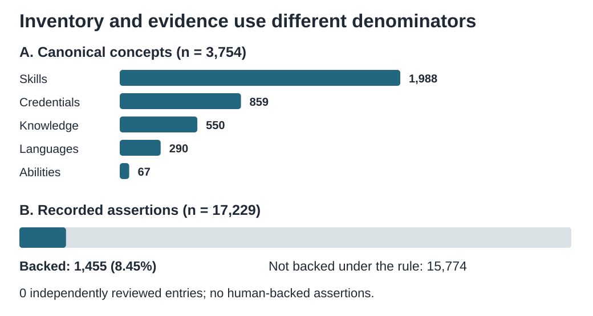

# The Irreducibly Human Work Lexicon: Separating a Match from a Verified Claim

*Rough revised reading copy, 27 November 2026. The [original working manuscript](../manuscript.md) and its audit pin are unchanged.*

> **Running a blind edition?** Use the pinned replication kit, not this paper, other model outputs, or review notes.

## Abstract

A terminology system for job postings and curricula needs to answer two different questions: which concept a mention refers to, and what evidence supports a particular assertion about that concept. The Irreducibly Human Work Lexicon uses canonical identifiers and aliases for the first question and records claim-level evidence for the second. A documented audit of a pinned tree found 3,754 canonical records and 17,229 assertion fields, of which 1,455 (8.45%) met the repository's source-backing rule. No entry was independently reviewed in that snapshot. One wrong-sense source match illustrates why recorded evidence is not source verification. We propose separate held-out tests for concept linking and reviewer decisions. The audit describes resource readiness, not accuracy, labor demand or learning.

## Introduction

“Postgres” in a vacancy and “PostgreSQL” in a syllabus can point to one canonical entity. That resolution neither establishes that the vacancy's task is performed nor that students attain proficiency. A second mistake occurs if resolving a term is treated as proof of the definitions and relationships attached to it. The contribution is a representation that makes these mistakes visible and contestable.

The distinction also matters across classes. A named library and a developed skill can both occupy the broad skill class, but their counts answer different questions. Similarly, a credential label describes a qualification that may be stated, not a verified holder. Existing work on [SkillSpan](https://doi.org/10.18653/v1/2022.naacl-main.366) represents span extraction while [Entity Linking in the Job Market Domain](https://doi.org/10.18653/v1/2024.findings-eacl.28) concerns linking. The versioned resource supplies an inspectable inventory and a separate review state; this audit does not compare accuracy with either project.

## Methods

### Vocabulary representation and audit

The representation records a canonical identifier, label, variants and kind, with assertion fields and available evidence references. Resolve a spelling variant to a candidate sense before deciding whether the source actually supports any assertion about that sense. A structurally valid record passes schema checks; a source-backed assertion meets the recorded criterion; a reviewed entry requires a separate, named review. These stages use different denominators.

The audit in the original manuscript pinned public commit `3cd82a454877e83d3f7eb989136de1d234e9944e`. Its [reproducibility note](../REPRODUCE.md) and [audit output](../inventory-recount.json) describe the version and procedure. The recount is a census of that tree: no sampling interval is informative for these exact counts. Independent drafts, branch-specific entries and unreported syllabus exercises do not change this denominator. No new raw data or draft outputs were used for this reading copy.

## Documented results

| Unit | Count | Meaning |
|---|---:|---|
| Canonical records | 3,754 | 1,988 broad skill, 550 knowledge, 67 ability, 290 language, 859 credential. |
| Assertion fields | 17,229 | Field denominator, not number of record-level decisions. |
| Source-backed fields | 1,455 | Recorded qualifying matches; 15,774 fields did not meet the rule. |
| Independently reviewed records | 0 | This audit pin only; not a statement about later hand-ins. |

**Figure 1.** Existing inventory figure for the pinned source tree. Record class and field backing use separate denominators. A missing source reference does not distinguish a correct, incorrect, or unresolvable assertion.

The original manuscript's Service orientation example links a workplace helping concept to a description about software architecture. The recorded Wikipedia match counts as backing under the audit rule, but the relevant senses differ. This is an observed counterexample to treating backing as verification, not an estimate of the frequency of such errors.

## Proposed evaluations

**Linking.** Freeze the target inventory and split by document/source family before tuning. Label spans with independent raters masked to outputs; allow unresolved ambiguity and absence from inventory. Compare normalized alias matching and context-aware matching on an identical inventory. Evaluate end-to-end span-plus-ID precision and recall, ID accuracy conditional on a gold span, and correct abstention for unseen or unresolved concepts. For systems with a threshold, show error by coverage so abstaining on every hard case cannot look like improvement. Use stratified challenge cases to locate failures, and keep their rates separate from any estimate based on a representative frame.

**Review.** Give independent reviewers access to the same source set, with or without an organized source trail, under the same time constraint. Counterbalance distinct but matched claims so a reviewer does not see the same item twice. Use independently adjudicated dispositions for retain, correct and unresolved, plus elapsed review time. Separate disagreement before adjudication from agreement with the final reference. [ASSUMPTION: permitted excerpts and reviewer participation can be arranged.] [NEEDS: prespecify a practically useful gain and obtain required approvals before recruiting or handling study data.]

## Discussion

The audit demonstrates traceability and its limits; neither a validator nor a citation match serves as a substitute for independent sense review. A practical publication gate is to confirm what class and fields the reader is about to count and which release state the query uses. The proposed tests ask when that distinction improves a task, not whether an inventory captures all capabilities. Neither employers' wording nor syllabus coverage establishes behavior or learning.

## Data and disclosures

The O\*NET 30.2 source is the U.S. Department of Labor, Employment and Training Administration; the project's matching and classifications are modifications. O\*NET data are CC BY 4.0; Wikipedia-adapted descriptions retain their revision-specific attribution and terms. See repository notices. No reviewer experiment was conducted and no employer text, syllabus, or private replication evidence is included here. [NEEDS: author roles, funding and competing-interest disclosures before submission.]
