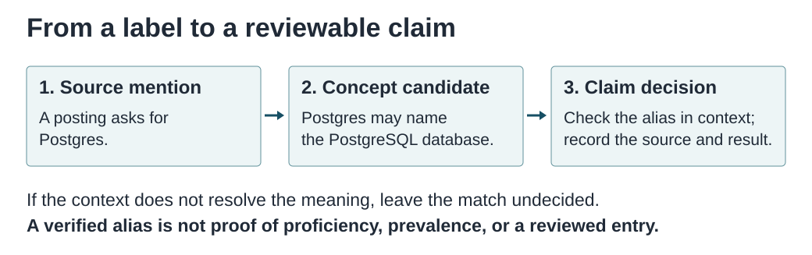
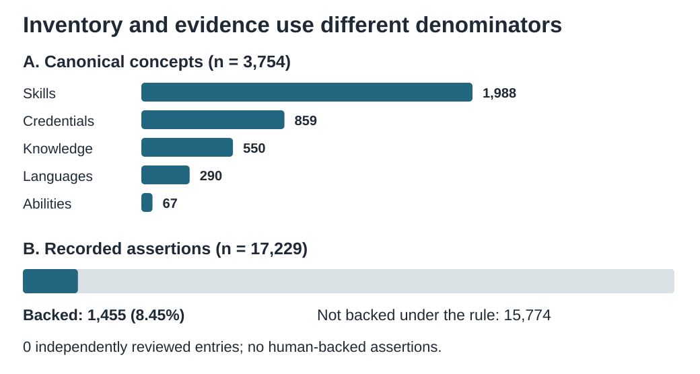

# Irreducibly Human Work Lexicon

**An auditable vocabulary for describing skills and other requirements across sources**

*Working manuscript v0.2. Not for submission. Authorship and acknowledgments remain to be confirmed.*

## Abstract

A job posting that asks for Postgres and a syllabus that names PostgreSQL can refer to the same technology. Neither mention independently validates a definition, shows that a worker uses the tool, or establishes student proficiency. The Irreducibly Human Work Lexicon separates a concept's identifier and matching rules from evidence for particular assertions about it. We describe its implementation and audit a pinned repository snapshot containing 3,754 canonical concepts and 17,229 assertion fields. Of these fields, 1,455 (8.45%) meet the repository's qualifying backing rule; none are backed by a named human check, and no entry is independently reviewed. These are measures of the state of the resource, not of its accuracy or the labor market. We propose a held-out evaluation of both mention-to-concept matching and the usefulness of claim-level provenance for reviewers.

## 1. Introduction

The task is not to make a longer list of familiar words. It is to decide when two names stand for the same concept, when they only describe related concepts, and what evidence warrants each decision. A short form such as PG can require context. A request for a database certification and a reference to a database technology are not interchangeable. Even when a form matches exactly, a posting can describe a preferred qualification, a course syllabus can describe planned instruction, and an occupation database can describe work at an aggregate level. All three are useful sources, but their claims differ.

We ask what a vocabulary must record to make these decisions reviewable by someone other than its original author. The implemented artifact provides stable identifiers, contextual variants, typed relations, and evidence tied to individual fields. We audit the artifact, not its effectiveness. Whether explicit context and provenance improve extraction and review is an empirical question, not a conclusion of this draft. The project name does not imply that the inventory measures which work cannot be automated.

## 2. Related work

O*NET publishes occupational descriptors and ratings [1], and ESCO provides multilingual labels and links among skills and occupations [2]. They supply reference concepts and structures rather than measurements of what every worker or employer does. SkillSpan studies where skill mentions appear in job postings [3]. Entity Linking in the Job Market Domain studies linking fine-grained mentions to ESCO concepts [4]. SkiLLens addresses recognition and mapping of potentially novel skills [5]. These are different tasks: finding text spans, resolving identifiers, and proposing vocabulary additions. We build on that distinction, and do not claim to improve on any of these methods. PROV-O provides a general model for representing provenance [6]; the lexicon's evidence schema is specific to this project and is not asserted to implement PROV-O.

## 3. Methods

### 3.1 Representation and matching

The unit of the vocabulary is a canonical record with a stable identifier, preferred label, kind and definition. A surface form can be case-sensitive or require context. The kind distinguishes developed skills from tools, methods and other concepts that the current summary groups into its broad skill class; that class is reported separately from knowledge, abilities, languages and credentials. Typed, directed relations connect records without declaring their labels interchangeable. Counting an occurrence toward a broader concept is a separate, explicit decision.

For example, the pinned PostgreSQL record stores Postgres as a case-insensitive word match. The form PG is case-sensitive and lists database as a context condition. The same record separately encodes a link toward SQL. This is an example of what the representation can express, not an endorsement of that relation or a measurement of matching quality. The PostgreSQL record itself is machine-drafted.

*Figure 1. What the data model keeps distinct. A matched string or context rule nominates a canonical concept, while field-specific evidence may support or contradict a definition, relation, or other assertion. Duty-level facet annotation is a research proposal, not a feature audited here.*

### 3.2 Claim backing and entry review

An assertion is a field in an entry, such as its definition, kind, a variant or a relation, identified by the validator's claim-key rules. Evidence records distinguish drafting from checking or matching a source. The repository counts a claim as backed if it has at least one qualifying supporting record: a named human check or a verified source match. Multiple supporting records for that same claim do not increase the count. A model check, a search-result snippet, or a contradictory response alone cannot qualify a claim as supported. These operational rules are not a truth test. For example, source-backed support for a definition does not show that its aliases are correct. The stricter entry status `reviewed` operates at the whole-record level under the repository's review rules.

### 3.3 Snapshot and analysis procedure

We archived commit `3cd82a454877e83d3f7eb989136de1d234e9944e` of the named public repository [7]. From that source tree we ran the validator and inventory summary below. We counted canonical records by their derived broad class and recorded status. We counted assertion fields and the subset with qualifying backing across the same entries. The claim-backing percentage is 100 multiplied by 1,455 divided by 17,229, rounded to two decimal places. It is not a proportion of entries. Data from unpublished branches and the provisional syllabus exercise described in the original manuscript are excluded from the inventory and the main findings. No external model, job postings, syllabus PDFs, or new labor-market estimates are required to rerun these counts.

~~~sh
git clone https://github.com/nikbearbrown/irreducibly-human-work-lexicon
cd irreducibly-human-work-lexicon
git switch --detach 3cd82a454877e83d3f7eb989136de1d234e9944e
python3 -I tools/lexicon.py validate
python3 -I scripts/summary_stats.py
~~~

## 4. Findings

*Figure 2. Inventory and review readiness of a pinned snapshot, with separate denominators for records and claims. The broad skill class includes named technologies and methods. Backing is a property of specific assertions, not a substitute for independent entry review.*

The inventory contains 1,988 broad-class skills, 550 knowledge concepts, 67 abilities, 290 languages and 859 credentials. Only 723 of the 1,988 broad-class skill records have the narrower developed-skill kind; the rest include technologies, methods, standards, and other kinds. The validator found no structural errors. It counted 3,555 machine-drafted and 199 proposed records, with zero reviewed or deprecated records. Of 17,229 assertion fields, 1,455 qualified as backed and 15,774 did not. No qualifying backing was attributed to a named human check. An assertion with no qualifying backing may be correct, incorrect or ambiguous; the audit does not distinguish them. Likewise, a record that passes validation is structurally valid, not necessarily substantively right.

## 5. Proposed evaluation

### 5.1 Matching: when does context help?

Create a held-out set of openly reusable or permissioned job and course excerpts. Fix the evaluation inventory version before annotation. Sample clear aliases, ambiguous short forms, near-misses, and concepts not in the inventory. Group by source/template families to avoid near-duplicate leakage, and separately hold out whole concepts when assessing generalization beyond known labels. Stratify the sampling and report the strata so deliberately ambiguous examples are not mistaken for their naturally occurring frequency.

Two independent raters, masked to system output, identify relevant spans, choose a canonical concept when justified, or annotate unresolved ambiguity or out-of-vocabulary status. Report disagreement before adjudication and document the adjudication rule. Compare a normalized exact-form baseline with context-aware matching using the same inventory. Measure span and concept-level precision, recall, and abstention coverage, showing uncertainty intervals and separate results for job and course sources. Compare error and abstention together: a cautious matcher should not appear better merely by refusing every hard example.

### 5.2 Review: when does provenance help?

In a separate, counterbalanced reviewer exercise, compare viewing the same types of entries with or without field-level provenance. Have reviewers decide which assertions warrant acceptance, correction, or an explicit unresolved label. Measure decision accuracy against an independently adjudicated reference, review time and identifying unsupported or contradicted assertions. Include cases with weak or conflicting provenance; the test is whether evidence improves decisions, not whether any citation increases confidence. Define the minimum useful improvement and tolerable precision–coverage trade-off before the study, using pilot observations only for planning.

A related extension asks what facets of human work a particular stated duty exhibits. Start with a duty excerpt rather than an occupational title. Permit multiple labels, insufficient evidence, and disagreement, all with textual support. Keep facet labels independent from canonical concepts, entry quality and automation exposure. Start with synthetic calibration examples, then test reproducibility with real reusable text if appropriate. Neither the audit nor the proposed rubric establishes that a facet is exclusive to humans.

## 6. Limitations and conclusion

The input inventories and drafting methods are not a probability sample of work. Existing source links can provide traceability without guaranteeing correctness. The original draft's model-assisted syllabus exercise shows a potential application, but its observation-level release is not part of this reproducible audit; it cannot establish extraction accuracy, skill coverage, or student learning. Job postings would tell us about phrased requirements, not how people spend their time or perform duties. O*NET level ratings summarize occupational information, not individuals. The unreviewed entries should not drive published skill counts under the repository's own policy.

The lexicon's current contribution is a way to inspect and contest vocabulary decisions. It offers useful review targets precisely because most claims still lack qualifying evidence. The next step is to validate what the representation buys in a held-out matching and review exercise, not to claim that the vocabulary captures everything humans do.

## References

1. U.S. Department of Labor, Employment and Training Administration. [O*NET Database Releases, 30.2](https://www.onetcenter.org/db_releases.html).
2. European Commission. [ESCO Skills and competences](https://esco.ec.europa.eu/en/classification/skills).
3. Zhang, Jensen, Sonniks, and Plank. 2022. [SkillSpan: Hard and Soft Skill Extraction from English Job Postings](https://doi.org/10.18653/v1/2022.naacl-main.366).
4. Zhang, van der Goot, and Plank. 2024. [Entity Linking in the Job Market Domain](https://doi.org/10.18653/v1/2024.findings-eacl.28).
5. De Santo, Malandri, Mercorio, Mezzanzanica, and Nobani. 2026. [SkiLLens: Recognising and Mapping Novel Skills from Millions of Job Ads Across Europe Using Language Models](https://doi.org/10.18653/v1/2026.eacl-industry.65).
6. Lebo, Sahoo, and McGuinness, eds. 2013. [PROV-O: The PROV Ontology](https://www.w3.org/TR/2013/REC-prov-o-20130430/). W3C Recommendation.
7. Irreducibly Human Work Lexicon. [Pinned repository tree](https://github.com/nikbearbrown/irreducibly-human-work-lexicon/tree/3cd82a454877e83d3f7eb989136de1d234e9944e) and [recount script](https://github.com/nikbearbrown/irreducibly-human-work-lexicon/blob/3cd82a454877e83d3f7eb989136de1d234e9944e/scripts/summary_stats.py).
